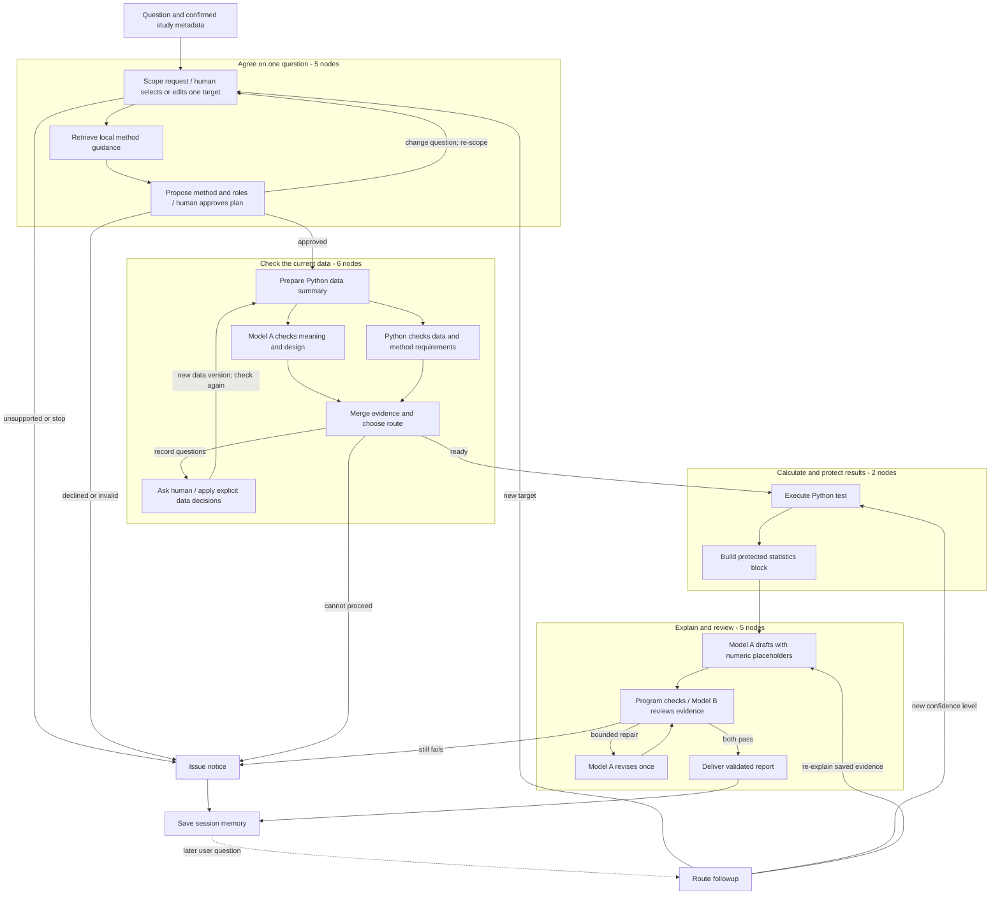

# Course alignment: confirmed questions, tools, and review

Status: 2026-11-01. The active graph in [workflow.py](../stat_assistant/workflow.py) has **21 executable nodes**, two agent roles, deterministic Python statistical tools, and explicit human decisions. Model A scopes, plans, diagnoses, and explains. A different Model B reviews the explanation against the statistical evidence. Several nodes reuse Model A; a node is not automatically a separate agent.

This document describes the current project. The dated midterm and earlier assignment submissions remain historical snapshots.

## A diagram for explaining the workflow

The diagram groups related executable nodes so classmates can follow the decisions. A box can contain more than one real node; the table below accounts for all 21. Arrow labels describe routing conditions, rather than additional agents.

| Teaching group | Actual executable nodes | Count |
|---|---|---:|
| Agree on one question | `scope_request`, `request_scope_confirmation`, `retrieve_method_guidance`, `plan_analysis`, `approve_analysis_plan` | 5 |
| Check data and resolve record questions | `prepare_data_summary`, `llm_diagnostics`, `stat_diagnostics`, `merge_diagnostics`, `request_clarification`, `apply_corrections` | 6 |
| Calculate and protect evidence | `run_statistical_test`, `build_stats_block` | 2 |
| Explain, check, revise, and deliver | `draft_report`, `check_report`, `review_report`, `revise_report`, `deliver_report` | 5 |
| Stop and retain session state | `issue_notice`, `save_session` | 2 |
| Route a later user request | `handle_followup` | 1 |
| **Total** | Optional branches are real nodes, even when a particular run skips them. | **21** |

The full edge definitions and role labels are in [workflow.py](../stat_assistant/workflow.py). Runtime errors also route to an issue notice; the teaching diagram omits repeated error arrows.

## Where the course concepts appear

Page numbers below are one-based PDF pages, checked against neighboring slide titles. The lesson PDFs are course materials outside this repository.

| Course material | Lesson concept | Current implementation and limit |
|---|---|---|
| **Module 5 RAG, p.125**, “The Four Pipeline Nodes”; details pp.121-136 | `retrieve → generate → double_check → doc_finalizer` | `retrieve_method_guidance` supplies local method cards; `draft_report` generates an explanation after computation; `check_report` and `review_report` check it; `revise_report` and `deliver_report` perform bounded finalization. The slide's fourth node is **`doc_finalizer`**, which revises or returns the answer. It is not a separate “summarizer” node. |
| **Module 5 Tool-Use, p.14**; schemas and returned results pp.12-16 | The LLM returns a tool name, arguments, and call ID; the application executes the tool and returns a matching `ToolMessage`. | Real Model A uses `bind_tools`. It must select exactly one allowlisted statistical tool with an ID and schema-valid plan arguments. Execution waits for plan checks and, in the interactive user flow, human approval. Drafting receives an `AIMessage`/`ToolMessage` exchange with the matching ID and actual result. |
| **Module 5 Tool-Use, p.95**, “Assembling the Graph”; context pp.85-94 | Plan first, execute focused steps, retain results, then produce the response. | The project has an explicit method plan and ordered execution stages, stateful evidence, conditional branches, and bounded repair loops. Its execution pipeline is deliberately fixed. It does not claim to implement an arbitrary list-of-steps executor or automatically run every extracted question. |
| **Module 6 Multi Agent, pp.35-36**, “Multi-Category Tasks” | A multi-goal prompt needs an explicit policy: ask for one problem, expose a UI choice, or extract and route multiple goals. | The project exposes candidates and asks the human to select **one target per run**. They can edit the question, which is scoped again. Other targets require separate runs. This follows the UI/user-input option rather than an automatic all-tests batch. |

The native tool protocol is implemented in [agents.py](../stat_assistant/agents.py). [nodes.py](../stat_assistant/nodes.py) validates the plan and constructs the deterministic statistical request; [tool_bridge.py](../stat_assistant/tool_bridge.py) records tool inputs and outputs. The application remains responsible for execution. A model's tool call is a proposal, not permission to run arbitrary code.

Mock agents use explicit rules and do not call an LLM. Their outputs demonstrate the graph and real Python arithmetic; they do not demonstrate native model tool selection or model reasoning quality.

## Human approval and request scope

The browser UI and `demo.py` CLI request plan confirmation. The human sees the question, method, roles, direction/hypotheses, and ordered workflow before execution. They can approve the displayed plan, request a new question/plan, or stop. The approval ID binds the proposed plan, question, and current planning data fingerprint. Record corrections remain separate explicit decisions and create a retained data version.

The programmatic helper `new_run(..., require_plan_confirmation=False)` retains its default for noninteractive callers. Such a run records `not_requested_programmatic_run`; it must not be described as human approved. Use `require_plan_confirmation=True` when a programmatic demonstration should pause for approval. The CLI pauses without inventing answers when `--interactive` is absent; add `--interactive` to supply terminal decisions.

Scoping produces at most four candidate tasks. Selection and re-scoping are bounded; the current limits permit three selection rounds and two user-requested question changes at plan approval. Automatic plan repair and report revision each permit one attempt; data clarification permits two answered rounds. These limits constrain a run rather than guaranteeing correct semantic classification.

An ambiguous request should be clarified before a test is selected. An unsupported target should stop. The workflow does not silently switch from chi-square to Fisher, replace an adjusted question with several unadjusted tests, remove records, or execute every mentioned analysis. Row/date filtering needs a separate prepared CSV and confirmed design metadata. Followups can reuse validated evidence for re-explanation, recompute a supported confidence interval, or return to scoping and planning for a new target.

## What retrieval means here

[references.py](../stat_assistant/references.py) contains **six curated, project-authored method cards** with primary SciPy documentation links. A lexical matcher scores the question against card keywords and returns up to three positive-score cards. Zero-score cards are excluded; no match returns an empty list.

The returned card text and provenance travel with the plan and later report/review context. These are local author-written guidance notes linked to sources, not fetched quotations from those sources. The retriever does not use embeddings, a vector database, or the full course textbook/PDF collection. It is a small document-retrieval component; the CSV descriptive summary is a different statistical operation. Calling this full textbook RAG would overstate its scope.

## Supported statistical targets

The project now supports **six** methods. Paired t and Fisher exact are the two additions to the earlier four-method version.

| Method | Question and required structure |
|---|---|
| Welch independent-samples t-test | Difference in numeric means for two independent groups, with explicit group order. |
| **Paired t-test** | Mean within-pair difference `y minus x`; one pair per row, with independence between subjects/pairs explicitly confirmed. Incomplete pairs require a human decision. |
| Pearson correlation | Linear association between two numeric variables. |
| Simple ordinary least squares | Numeric outcome on one numeric predictor, with roles and direction specified. |
| Pearson chi-square independence | Association between two categorical variables, subject to the project's expected-count policy. |
| **Two-sided Fisher exact** | An explicitly planned two-by-two categorical table. Table ordering is reported; the sample odds ratio can be infinite or undefined. An effect confidence interval is not implemented. |

No method turns an observational association into a causal conclusion. A small p-value does not fix an inappropriate question, study design, or data transformation.

## Classroom examples and evidence

Use the paired sleep plot and the Berkeley department plot to make the workflow's decisions visible. [THREE_SLIDE_STORY.md](THREE_SLIDE_STORY.md) provides the talk track. The optional Anscombe quartet illustration can show why similar statistics still require inspecting plots; it is published constructed teaching data, not an empirical study.

The source snapshots, transformations, study descriptions, numerical references, and checksums are documented in [the public-reproduction manifest](../examples/public_reproductions/manifest.json). In particular, Berkeley's frequency-expanded CSV reproduces aggregate counts; its generated row labels are not original applicant identifiers.

| Evidence location | What it supports |
|---|---|
| [Saved mock reproduction summary](../examples/public_reproductions/evidence/mock_20261101_v2/summary.json) and neighboring case JSON/SVG files | Rule-based agent runs with real Python calculations. Inspect each case's numerical comparison and workflow status separately. These saved runs predate some current graph edits. |
| [Saved plan-confirmation example](../examples/public_reproductions/evidence/mock_plan_confirmation_20261101_v1/summary.json) | A recorded pause awaiting an explicit decision. A pause is not a delivered report or an approval. |
| [Separate live-run evidence](../examples/public_reproductions/evidence/real_20261101_v1/summary.json) and neighboring case JSON files | The recorded real-model attempt and its per-case statuses. It is separate from mock evidence and does not establish that today's updated graph has passed a fresh live run. |

The final [real three-case run](../examples/public_reproductions/evidence/real_20261101_final/summary.json) delivered the sleep, Berkeley and first Anscombe targets with matching independent numerical results. Its predefined benchmark approval is not human approval. The current software suite passed 262 tests; those mocks are not model accuracy evidence. Report numerical agreement, workflow delivery, native tool-call behavior, and real-model review quality as separate evidence. Earlier assignments and saved outputs should retain their original labels and dates.
