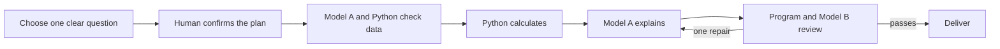
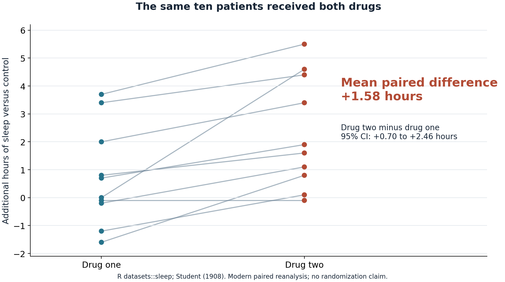
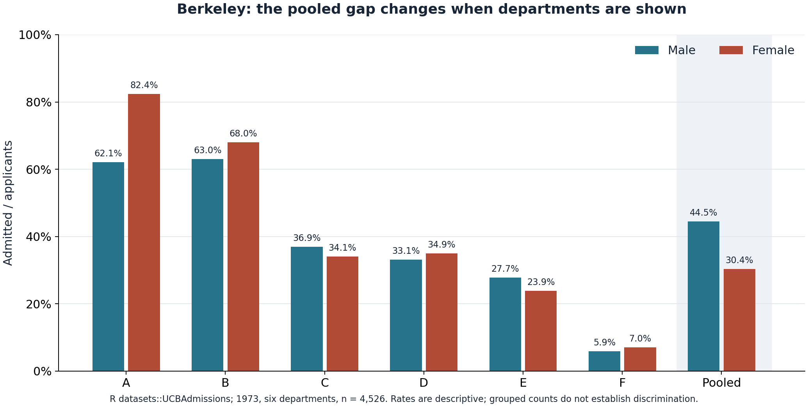

# Three slides: from a question to a defensible explanation

Audience: classmates who know the agentic-AI course but may not know statistical tests. Target length: about three to four minutes. Keep the full 21-node graph in backup material; use a short pipeline on the first slide and let the two data plots explain why the decisions matter.

These are slide content and speaker notes, not a claim that a new slide deck or live-model run has been produced. Earlier midterm slides remain frozen.

## Slide 1: Confirm the question before calculating

**Slide title:** “The assistant asks what we mean before it tests anything.”

**On the slide:**

> One question → Confirm a plan → Check the data → Calculate → Explain → Review

**Three small role labels:** Human chooses and confirms. Python computes numbers. Two different models plan/explain and review.

**Speaker notes, about 60 seconds:**

“Typing a broad question does not tell us which comparison is intended. If someone asks for several analyses, we show the targets and ask them to choose one for this run. They can edit the question, and the system checks its scope again. Then we show the proposed method, variables, comparison direction, and steps for approval.

“Model A can request a statistical tool. The Python program checks and executes it after the approval step; the language model does not calculate the answer itself. Python protects the numbers, Model A explains them, and a different model reviews the explanation against the evidence. If the checks still fail after one revision, the system stops with an explanation.

“This short picture groups 21 real workflow nodes. The course connections are tool calling, explicit state and routing, human input, and generate-check-finalize. The lesson's final stage is `doc_finalizer`; we have not invented an extra summarizer.”

**Demonstration cue:** In the browser, show the pending plan before approving it. For a terminal demonstration use `demo.py --mode mock --interactive`. A noninteractive CLI run pauses; it does not approve itself. Programmatic `new_run` still defaults to confirmation disabled, so enable `require_plan_confirmation=True` for a human-approval demonstration.

**Do not imply:** automatic execution of all extracted questions, automatic method fallback, or that mock agents demonstrate real LLM performance. Local retrieval searches six curated method cards with source links; it does not query a textbook vector database. Zero-match guidance is omitted.

## Slide 2: Same people means a paired question

**Slide title:** “Keep the same person's two measurements together.”

**Main visual:** [Paired sleep plot](../examples/public_reproductions/classroom_plots/student_sleep.png), with [SVG](../examples/public_reproductions/classroom_plots/student_sleep.svg) for scaling. Keep the patient connections visible rather than showing two unrelated bars.

**Question on the slide:** “For the same ten patients, what is the mean difference in additional sleep: drug 2 minus drug 1?”

**One result line:** **+1.58 hours · 95% CI 0.70 to 2.46 · two-sided p = 0.00283**

**Small source line:** Historical sleep data preserved in R `datasets::sleep`; modern paired t-test reanalysis. Student (1908), drawing on Cushny and Peebles (1905). Source snapshot and transformation: [manifest](../examples/public_reproductions/manifest.json).

**Speaker notes, about 60 seconds:**

“Each line connects two measurements from the same patient. That pairing changes the question: we compare the differences within people, rather than pretending these are two unrelated groups. The user must confirm the study structure; a CSV alone cannot tell us that the pairs are independent of other pairs.

“For these ten historical pairs, Python computes an average difference of 1.58 additional hours for drug 2 minus drug 1. The modern 95% confidence interval is about 0.70 to 2.46 hours. The p-value is evidence against a zero mean difference under the paired-test assumptions; it does not prove a treatment claim.

“The AI contribution is choosing and confirming the intended question, keeping the pairing, explaining the computed result, and checking that the wording stays within the evidence. The number comes from Python.”

**Claim boundary:** These figures are a modern two-sided reanalysis of the preserved values. They are not Student's original p-value wording, a new randomized trial, or current treatment advice. Paired t is one of two added methods; the other is explicitly planned two-sided Fisher exact for a two-by-two table. The project supports six methods in total.

## Slide 3: A pooled gap can conceal group structure

**Slide title:** “A large overall gap is not the whole question.”

**Main visual:** [Berkeley admission rates by department and pooled](../examples/public_reproductions/classroom_plots/berkeley_admissions.png), with [SVG](../examples/public_reproductions/classroom_plots/berkeley_admissions.svg) for scaling. Show all six departments and the pooled comparison together.

**Two callouts:**

- Pooled admission rate: **men 44.52% · women 30.35%**.
- Within departments: **female rates are higher in four and lower in two**; the pattern does not reverse in every department.

**Small source line:** Six-department 1973 Berkeley admissions counts in R `datasets::UCBAdmissions`; Bickel, Hammel, and O'Connell (1975). [Preserved counts](../examples/public_reproductions/berkeley_counts.csv) and [manifest](../examples/public_reproductions/manifest.json).

**Speaker notes, about 70 seconds:**

“If we show only the pooled bars, male applicants have a higher admission rate: about 44.52% versus 30.35%. But the department-level picture is different. Female rates are higher in four departments and lower in two. The groups applied to different mixes of departments, so the pooled comparison and within-department comparisons answer different questions.

“Our current test can report the pooled association for these six departments. The department rates here are descriptive context. We should not present that result as a department-adjusted causal analysis, or claim that every department reverses the pooled pattern.

“This is why an assistant must check the question and review the explanation. A correctly calculated statistic can still support an overstated story. The program protects the numbers; the review stage checks claims such as whether association was turned into causation.”

**Claim boundary:** The source consists of aggregate frequency cells. The tool's expanded CSV repeats those counts deterministically; generated row IDs are not original applicant records. This example does not reproduce the original article's whole-university adjusted significance and cannot establish a causal account of discrimination.

## Optional substitute or backup: Anscombe's quartet

**Title:** “Similar statistics can hide very different pictures.”

Anscombe's quartet is **published, constructed teaching data from 1973**, not a new empirical dataset. Four datasets have nearly identical common summary statistics and fitted regression lines, while their scatterplots differ markedly. Say “nearly identical,” rather than claiming every statistic is exactly equal.

Use the optional four-panel figure at `examples/public_reproductions/classroom_plots/anscombe_quartet.png` or its SVG, with source provenance in the public-reproduction manifest. The comparison of all four panels is a descriptive teaching display. A workflow run should still approve one question, such as fitting `y1` on `x1`; the figure is not evidence that the graph automatically executed four tests.

**Twenty-second explanation:** “A curve, an unusual point, or a concentration of x-values can disappear inside a summary number. Looking at the plot is part of understanding what the number means. Our application should stop or qualify claims when the requested interpretation goes beyond its supported checks.”

## Evidence label for the presentation

Use this footnote on slides that show saved reports:

> Saved mock runs use rule-based agents and real Python calculations. Live-model evidence is recorded separately; a paused or stopped run is not a delivered report.

Keep the [saved mock summary](../examples/public_reproductions/evidence/mock_20261101_v2/summary.json), [saved approval pause](../examples/public_reproductions/evidence/mock_plan_confirmation_20261101_v1/summary.json), and [separate live-attempt summary](../examples/public_reproductions/evidence/real_20261101_v1/summary.json) available as backup. These are dated records; do not describe them as a fresh validation of every current graph change. Numerical agreement, report delivery, human approval, and model interpretation quality are separate claims. The current [real three-case run](../examples/public_reproductions/evidence/real_20261101_final/summary.json) delivered all three prespecified targets and matched independent numerical references. The harness supplied predefined plan approval, explicitly logged as not human approval; no data-handling decisions were supplied. This small demonstration does not establish general model accuracy or human-rated interpretation quality.

For the full node accounting and course-page mapping, see [COURSE_ALIGNMENT_2026-11-01.md](COURSE_ALIGNMENT_2026-11-01.md).
